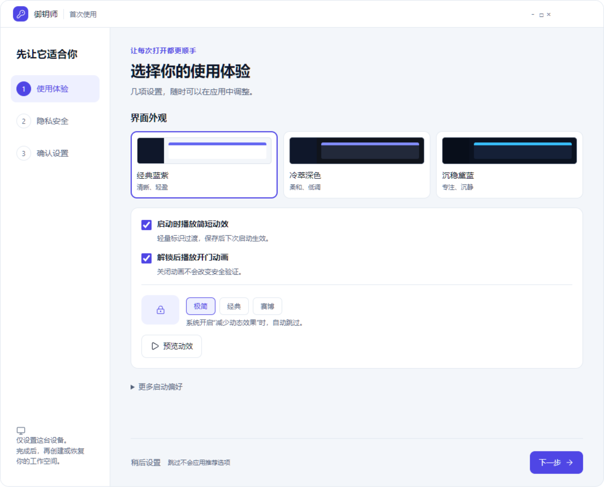
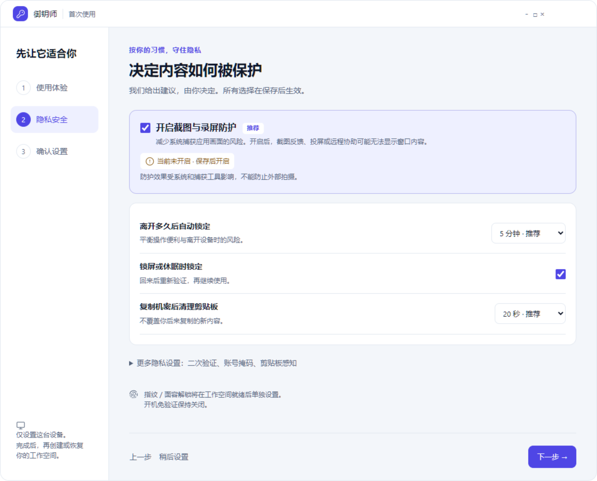
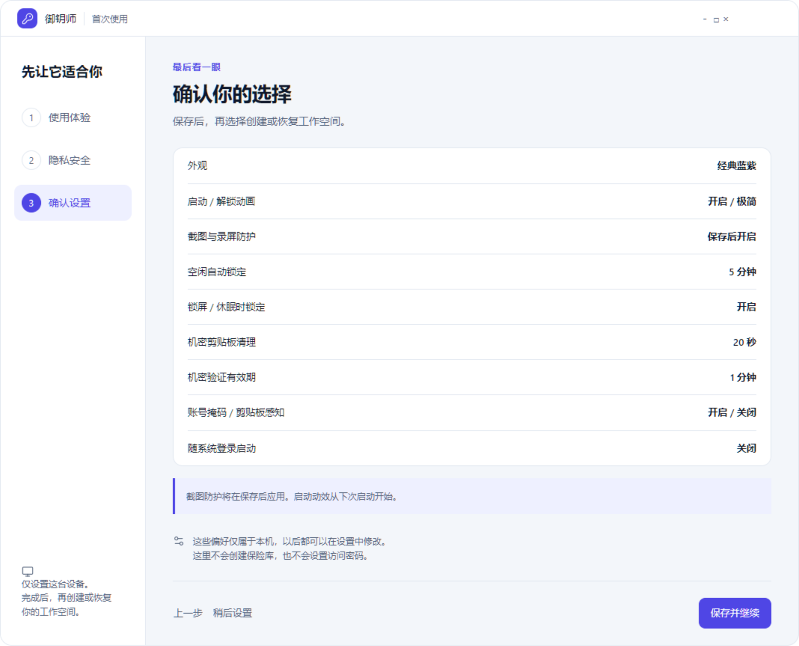
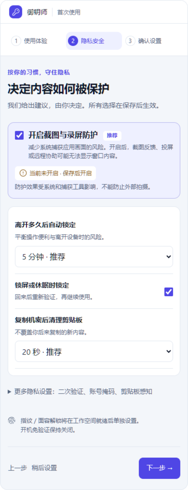

# 御钥师首次使用引导设计稿

本目录顶层是方案评审设计稿，功能现已接入应用。实际 React 页面截图及验收证据位于 `implementation/`；详见 [实施记录](../../首次使用引导实施记录.md)。设计预览本身仍不连接真实 IPC。

- [完整方案与设置分析](../../首次使用引导方案.md)
- [可交互预览](preview.html)：三步推荐方案与一页备选，支持主题、选择、前后步骤、跳过和确认的本地模拟。
- 原型源：`.xiaojiu/visualizations/first-run-onboarding.html`。

## 页面设计图

| 设计 | 查看 |
| --- | --- |
| 桌面：使用体验 | [01-experience-desktop.png](01-experience-desktop.png) |
| 桌面：隐私与安全 | [02-security-desktop.png](02-security-desktop.png) |
| 桌面：确认设置 | [03-confirm-desktop.png](03-confirm-desktop.png) |
| 手机：隐私与安全 | [04-security-mobile.png](04-security-mobile.png) |
| 深色：隐私与安全 | [05-security-dark.png](05-security-dark.png) |
| 小屏：320 宽布局 | [06-mobile-320.png](06-mobile-320.png) |
| 备选：一页快速设置 | [07-quick-alternative.png](07-quick-alternative.png) |

### 推荐桌面方案

### 手机布局

## 预览验证范围

验证的是设计稿交互，而非产品实际功能：

- 三步导航、前后返回保持选择、确认摘要与选项一致。
- 推荐勾选时明确仍未生效；取消勾选保存与跳过都保持防护关闭的设计语义。
- 主题与动画预览、系统减少动态效果、折叠设置、两种方案切换。
- 桌面和 736 / 390 / 320 宽布局、鼠标悬停、键盘激活及手机触控。
- 深色标题对比度检查、浏览器脚本错误检查。

详见 [verification.json](verification.json)。`verify-preview.cjs` 为本机设计稿验证脚本，使用本地独立浏览器及开发工具依赖，不修改应用依赖文件。

原型没有连接真实 IPC，不访问真实保险库或剪贴板，不执行截图防护、不修改本机系统设置。截图表现为设计方案，不证明任何平台已经完成防截图功能验收。
