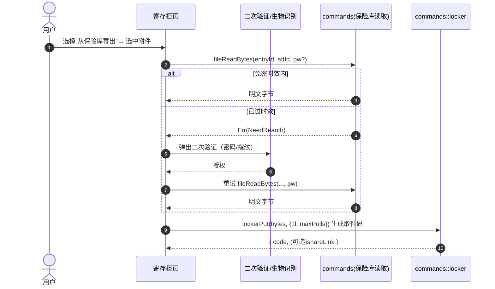

# 文件寄存柜设计

> 配套文档：`文件保险库与备忘录设计.md`（长期加密归档，区别于本文的"短命寄存"）、`规划设计.md`（保险库总体架构）、`个人档口.md`（Cloudflare Worker + D1 + Pages 部署骨架，分享链接复用其经验）、`网络代理设置设计.md`。
> 本文定位：在御钥师**工具箱**中新增一个传输/交接类工具——**文件寄存柜**。把文件加密寄存到用户自己的 R2，设定"存放时长 + 可取出次数"，到期或取完**自动焚毁**。一次寄存同时支持**自用自取**（同账号多设备，仅凭取件码）与**分享交接**（链接 + 取件码，对方无需安装御钥师）。
> 制定日期：2026-10-16 · 基线分支：`dev`
> 状态：**设计稿，待评审后分期实施**。本文只定方案，不含实现。

---

## 第一部分 · 目标与范围

### 1.1 它和「文件保险库」是两种东西

仓库已有「文件保险库」（长期加密归档、换机备份、只有本人持恢复密钥可取）。**寄存柜不是保险库的子功能，而是工具箱里的一个独立工具**，与 FileBeam（文件投送）同属"传输/交接"类：

| 维度 | 文件保险库（nav 模块） | 文件寄存柜（工具箱工具，本文） |
|---|---|---|
| 生命周期 | 长期，用户删才删 | **短命**，到期 / 取完**自动焚毁** |
| 目的 | 加密归档、换机备份 | 临时寄存、跨设备交接、阅后即焚分享 |
| 访问者 | 仅本人（持恢复密钥） | 本人（同账号设备）**或**拿到链接+取件码的他人 |
| 云端对象 | 内容寻址长存、去重 | 独立对象，带 TTL + 取出次数，到期即删 |
| 取件方式 | 在列表里解密导出 | **取件码**（自取）/ **链接+取件码**（分享） |

两者可互通（见 §7）：保险库里的文件可"寄出到寄存柜"，寄存柜取回的文件可"存入保险库"（复用 FileBeam 已有的 `/files?focus=<id>` 跨模块跳转范式）。

### 1.2 功能目标

| 编号 | 目标 |
|---|---|
| L1 | 在手机或 PC 选择本地文件，端到端加密后**寄存**到用户自己的 R2 |
| L2 | 寄存时设定**存放时长**：小时 / 天 / 月 / 永久（换算为 `expire_at`） |
| L3 | 寄存时设定**可取出次数**：N 次 / 不限（`max_pulls`） |
| L4 | **到时间**（不论是否取出）自动销毁；**取完次数**（不论是否超时）自动销毁；两者取先到者 |
| L5 | 每次寄存生成一个**取件码**。同账号的其他设备**仅凭取件码**即可取回（R2 相同、恢复密钥相同） |
| L6 | 可为同一寄存项生成**分享链接**，发给无御钥师的人；对方需**链接 + 取件码**才能下载解密。分享时可**复制链接**，并就地生成**链接二维码** |
| L7 | 允许**从文件保险库直接调取**文件再寄存——但调取前必须**访问密码二次验证**（安全红线，见 §7） |
| L8 | 分享链接：**不可枚举**（非自增 id）、**尽量短**、**一次性**；链接有效性与寄存文件同步，**文件失效则链接失效** |
| L9 | 寄存项元数据跟随现有**云同步**（零知识），多端看到同一批寄存项与剩余时效 / 次数 |

### 1.3 非目标（本期不做）

- 不做断点续传的多段分片上传（单对象 PUT；单文件硬上限沿用保险库口径 100 MB）。
- 不做"公开目录 / 匿名上传站"，分享永远是**点对点**（随机 slug + 取件码），不提供可浏览的文件广场。
- 不做服务端明文留存、不做服务端可解密——**全程零知识**（见 §4、§6）。
- 不做分享对象的在线预览；对方浏览器只做"下载 + 本地解密"。
- 不替代网盘：寄存柜是"短命 + 自毁"，长期文件请用文件保险库或专业网盘。

---

## 第二部分 · 核心概念与整体模型

### 2.1 四个基本对象

| 概念 | 说明 |
|---|---|
| **寄存项（LockerItem）** | 一次寄存 = 一个加密对象（存 R2）+ 一条元数据（存 `locker.enc`，跟随同步） |
| **内容密钥（CK）** | 每个寄存项一把**随机 256 位**密钥，用于加密文件字节。一项一钥，互不牵连 |
| **取件码（PickupCode）** | **6 位纯数字**。**自取时**作为选择器 + 访问闸；**分享时**作为服务端二因子。Worker 只存其哈希；加密的 `locker.enc` 内保留明文，供本人再次查看 |
| **分享链接（可选）** | `https://<短域名>/d/<slug>#<CK>`。`slug` 随机不可枚举；`#` 后的 CK 浏览器不回传服务器 |

### 2.2 一次寄存，两条取件路径（关键模型）

一次寄存**同时**具备两种取回方式，靠**信封加密 + 双重解包**实现：

```mermaid
flowchart TB
  F[本地文件明文] -->|随机 CK 分块 AEAD 加密| C[密文对象]
  C -->|PUT| R2[(用户自己的 R2)]
  CK[内容密钥 CK] -->|用保险库子密钥封装| WS[wrapSelf → 存 locker.enc 同步]
  CK -->|明文置于链接 #fragment| LINK[分享链接 #CK]
  subgraph 自取（同账号设备）
    WS -->|设备 B 用主密钥解封得 CK| D1dec[解密落盘]
  end
  subgraph 分享（他人浏览器）
    LINK -->|浏览器从 #fragment 取 CK| D2dec[WebCrypto 本地解密]
  end
```

- **自取路径**：同账号设备已把 `locker.enc` 同步过来，内含用**保险库子密钥**封装的 `wrapSelf(CK)`。设备 B 输入取件码定位到该项 → 用主密钥解封得 CK → 从 R2 下载密文 → 解密落盘。**不需要链接**。
- **分享路径**：他人没有恢复密钥、没有同步的元数据。CK 只出现在**链接的 `#fragment`**（服务器永不可见），取件码由 Worker 校验放行。对方浏览器拿到密文 + CK 本地解密。

> 一把 CK、一份 R2 密文，两种解包方式并存：自取靠"保险库封装的副本"，分享靠"链接片段里的明文 CK"。服务器两种路径都只见密文。

### 2.3 取件码的双重角色

取件码**一项一个**，自取与分享共用同一个码：

| 场景 | 取件码的作用 | 校验方 |
|---|---|---|
| 自取 | 在同步到本地的 `locker.enc` 里**定位**对应寄存项 + 访问闸 | 本地 App（比对 `code_hash`） |
| 分享 | 服务端**二因子**：链接定位对象，取件码授权下载 | Worker（比对 `code_hash`，带限速锁定） |

关键：**取件码不参与解密**（分享时解密靠 `#fragment` 的 CK）。因此 Worker 即使收到并校验取件码，也**拿不到 CK、解不了密**，零知识不破。
> 可选加固（见 §6.4）：分享路径最终密钥 = `HKDF(CK_fragment, 取件码)`，使"仅泄露链接、无取件码"也无法解密。作为 P4 增强项。

---

## 第三部分 · 数据模型

### 3.1 本地元数据（`data/locker.enc`，LABEL_METADATA 加密，跟随同步）

```rust
/// 寄存项（元数据；文件字节以随机 CK 加密后存 R2）。
#[derive(Debug, Clone, Serialize, Deserialize, PartialEq)]
#[serde(rename_all = "camelCase")]
pub struct LockerEntry {
    pub id: String,                 // 本地主键（随机）
    pub name: String,               // 展示名（默认取原名）
    pub original_name: String,      // 原始文件名（导出默认用它）
    pub mime: Option<String>,
    pub size: u64,                  // 明文字节数
    pub object_name: String,        // R2 对象名：HMAC(逻辑路径) 混淆，沿用同步命名，不可枚举

    pub pickup_code: String,        // 6 位数字。只活在已加密的 locker.enc 里，供本人再次查看/复制；不进 D1
    pub code_hash: String,          // 取件码的 HMAC。Worker 只存这个
    pub wrap_self: String,          // 用保险库子密钥封装的 CK（base64 AEAD 帧），供同账号设备解包，也可在分享有效期内重新拼出链接

    pub created_at: String,
    pub expire_at: Option<String>,  // None = 永久；新建默认 now + 24h
    pub max_pulls: Option<u32>,     // None = 不限次数；新建默认 1
    pub pulls_left: Option<u32>,    // 剩余可取次数（自取/分享共享同一计数，见 §5）

    pub share: Option<ShareMeta>,   // 是否已生成分享链接
}

#[derive(Debug, Clone, Serialize, Deserialize, PartialEq)]
#[serde(rename_all = "camelCase")]
pub struct ShareMeta {
    pub slug: String,               // 分享短 slug（随机、不可枚举）
    pub registered_at: String,      // 登记到 Worker 的时间
    // 注意：CK 不落本地明文、不进 ShareMeta；分享链接在生成当下一次性交给用户复制
}

/// data/locker.enc
#[derive(Debug, Clone, Serialize, Deserialize, Default)]
#[serde(rename_all = "camelCase")]
pub struct LockerData {
    pub entries: Vec<LockerEntry>,
    #[serde(default, serialize_with = "serde_maps::ordered_string_map")]
    pub deleted_entries: HashMap<String, String>, // id -> 删除/焚毁时间（墓碑）
}
```

- 复用现有 `serde_maps::ordered_string_map` 保证键序稳定、清单哈希可比对。
- 多端合并 `merge_locker_data(local, remote)`：条目按时间取新、墓碑传播删除；`pulls_left` 取**更小值**（谁取过以更少的为准，偏保守，宁可少取也不越限，见 §5.3 并发讨论）。

### 3.2 服务端（Cloudflare D1，仅"已分享"的项才登记）

D1 表 `locker`（**主键是随机 slug，杜绝自增 id**）：

| 列 | 含义 |
|---|---|
| `slug` | 主键。随机不可枚举短码（§6.1） |
| `object_key` | R2 对象键（= `object_name`，与公开 slug 解耦，进一步隐藏真实路径） |
| `code_hash` | 取件码 HMAC（服务端只存哈希） |
| `size` | 密文大小（流式吐出用） |
| `expire_at` | 过期时刻（UTC） |
| `max_pulls` / `pulls_left` | 次数上限 / 剩余 |
| `fail_count` | 该 slug 累计取件码错误次数（§6.3：满 20 吊销） |
| `status` | `active` / `revoked`（焚毁后置 revoked，随后清行） |

> 自取**不经过 D1**：同账号设备靠同步的 `locker.enc` 直接读 R2。只有生成分享链接时才 `POST /register` 写一行 D1。

---

## 第四部分 · 加密与密钥设计

### 4.1 新增子密钥标签（`vault/crypto.rs`，标签一经发布不可改）

```rust
/// 文件寄存柜：封装每项内容密钥 CK 的子密钥（v1.x）
pub const LABEL_LOCKER_WRAP: &[u8] = b"gam-locker-wrap-v1";
/// 文件寄存柜：取件码 HMAC 的子密钥
pub const LABEL_LOCKER_CODE: &[u8] = b"gam-locker-code-v1";
```

### 4.2 寄存时的加密流程

1. 生成随机 `CK`（256 位）。
2. 用 `CK` 对文件做**分块流式 AEAD 加密**（复用保险库 `store::blob` 的分块帧格式：`magic || version || chunk_size`，每块独立 nonce，AAD 绑定块序号，峰值内存 ≈ 一个分块——移动端 100 MB 文件不爆内存）。
3. 生成取件码；`code_hash = HMAC(LABEL_LOCKER_CODE, 取件码)`。
4. `wrap_self = AEAD(CK, key = master.subkey(LABEL_LOCKER_WRAP))`，写入 `locker.enc`。
5. 把密文对象 PUT 到 R2（对象名 = `HMAC(LABEL_SYNC_NAME, 逻辑路径)`，不可枚举）。
6. 写元数据、触发同步（`kick_publish`）。

**CK 明文绝不落盘**：用完 `zeroize`。本地只持有 `wrap_self`（需主密钥才能解）。

### 4.3 取件时的解密流程

- **自取**：输入取件码 → 本地比对 `code_hash` 命中条目 → 用主密钥解 `wrap_self` 得 CK → GET 密文 → 分块解密落盘 → 更新 `pulls_left`（§5）。解密即"查看机密"，走 `ensure_reveal_authorized`（吃免密时效，见 §8）。
- **分享**：对方浏览器从 `#fragment` 取 CK → 向 Worker `GET /api/<slug>` 带取件码 → Worker 校验（未过期、次数未尽、`code_hash` 匹配）→ 流式吐密文 → 浏览器 WebCrypto 本地分块解密。

### 4.4 为什么零知识成立

- R2 永远只有密文；对象名是 HMAC，不可枚举。
- 自取：CK 以保险库子密钥封装，只有持主密钥的同账号设备能解。
- 分享：CK 只在链接 `#fragment`，**浏览器规范保证 fragment 不进 HTTP 请求**，Worker/R2/CDN 日志都看不到 CK。
- Worker 只存取件码哈希。明文取件码只在已加密的 `locker.enc` 里，供本人再次查看，且**不参与解密**。

---

## 第五部分 · 销毁机制（把"真相"讲清楚）

两个销毁条件机制不同，分开实现，别指望单靠 Lifecycle。

### 5.1 按时间销毁

- R2/S3 Lifecycle 只能**按对象年龄、最细到天**整前缀过期，给不了"每项不同、精确到小时"的 TTL。
- 因此以**元数据 `expire_at` + 主动删**为主：
  - **自取（无分享）**：App 在"打开寄存柜页 / 启动 / 同步周期"时 sweep，`DELETE` 过期对象并打墓碑；长 TTL（天/月）可再配一条 Lifecycle 规则兜底。限制：App 不开则不实时删，但下次开必删 + Lifecycle 兜底。
  - **已分享**：Worker **Cron（每分钟）** 扫 D1，准时 `DELETE` R2 对象 + 置 `revoked` → 清行。**这才是"不管 App 开不开都准时焚毁"**。

### 5.2 按次数销毁

- R2/S3 无此能力，必须有"中介"计数：
  - **自取**：取件走 App——GET → 解密落盘 → `pulls_left - 1`，归零则 `DELETE` + 墓碑。**前提：绝不把裸 presigned URL 甩出去**，否则绕过计数。
  - **分享**：Worker 对 D1 做**原子递减**（`UPDATE ... SET pulls_left = pulls_left - 1 WHERE pulls_left > 0`），归零 `DELETE` R2 + 清行。原子性防并发多取。

### 5.3 计数权威：已分享过 Worker，未分享纯本地

同一寄存项的 `pulls_left` 只有一个权威源，按是否已分享分流：

- **已分享 → 过 Worker。** 自取和分享下载都先让 D1 原子递减，成功才放行下载。D1 是唯一计数。本地 `pulls_left` 只是展示缓存，以 Worker 返回值为准。
- **未分享 → 纯本地。** 不登记 D1、不经过 Worker。取件只在 App 内扣 `locker.enc` 的 `pulls_left`，归零再删 R2 对象。多端并发时 `merge_locker_data` 对 `pulls_left` **取较小值**。
- 焚毁是幂等的：对象已不在 → 视为已焚毁，双方收敛到墓碑 / 清行。
- 一项从"未分享"变成"已分享"时，把当时的 `pulls_left` / `expire_at` 原样登记进 D1，此后计数权移交给 Worker。

### 5.4 销毁即链接失效

- 已分享项焚毁时：删 R2 对象 + 清 D1 行 → `GET /d/<slug>` 与 `/api/<slug>` 一律 404。**链接有效性 = 文件存在性**，单一真相（R2 对象 + D1 行），无需单独维护"链接过期"。
- App 侧手动焚毁/删除已分享项时，一并调用 Worker `DELETE /register/<slug>` 吊销；Worker Cron 亦独立兜底。

---

## 第六部分 · 分享链接安全（针对补充点 3）

### 6.1 不可枚举 + 尽量短

- **slug 随机、非自增**：客户端用 CSPRNG 生成 **10 字符 base62 slug（≈59 bit 熵）**，`POST /register` 时若 D1 冲突则重试。杜绝"看到一个 id 就能猜下一个"。
- **短**：路径形如 `https://locker.你的域名/d/x7Qk2mAb9`，可读部分很短。
- 真正长的是 `#<CK>`（解密密钥，必要且不可省），但它在 `#` 之后，不影响"路径可猜测性"，复制整条即可。
- slug 与真实 `object_key` 在 D1 里映射解耦——公开的只是随机别名，R2 真实路径（HMAC）也不暴露。

### 6.2 取件码位数：定为 6 位纯数字

取件码要能念出来、在手机上敲进去，所以优先纯数字，长度压在 6～8。安全不靠把码加长，靠「码只是第二因子 + 错误次数有硬上限」。

攻击面只有一条值得算：对方拿到了链接或二维码，但没拿到取件码，对着 Worker 撞码。slug（约 59 bit）本身撞不开；只拿码、没有链接，也定位不到对象。

| 方案 | 空间 | 判断 |
|---|---|---|
| 4 位数字 | 1 万 | 太短。肩窥、连拍都能记住；累计 20 次尝试的命中率约 0.2%，对「把文件交给别人」偏高 |
| **6 位数字** | **100 万** | **采用。** 和短信验证码一样长，可分组显示成 `482 193`。累计 20 次尝试的命中率约 0.002% |
| 8 位数字 | 1 亿 | 命中率更低，但更难念、更容易敲错。有了次数硬上限之后，多出来的位数不再改变威胁模型 |
| 6～8 位字母数字 | 数十亿起 | 熵更高，却引入 0/O、1/l 误读。纯数字已经够，不必上字母 |

6 位成立，是因为撞码预算被封死，而不是因为 100 万本身撞不完：

- 若只做「错 5 次锁 15 分钟」、不封总次数，一个「永久」分享一年大约还能试 17 万次，6 位数字理论上几年内能被撞完。
- 因此 **累计错误 20 次即吊销该分享**（删 D1 行，链接 404，需本人重新生成）。20 / 1,000,000 = 0.002%，和 TTL 是 24 小时还是永久无关。
- 另外保留短锁：连续错 5 次锁 15 分钟，挡住脚本连打；边缘再限速。
- 默认 TTL 24 小时、默认可取 1 次，把窗口再收小一档。这两项是产品默认值，不代替上面的硬上限。

取件码可重新生成（旧码立即作废，`code_hash` 同步更新到 D1）。本人随时可从 `locker.enc` 里再次查看，不必只显示一次。

### 6.3 限速与锁定（防暴力撞取件码）

- 连续错误 **5** 次：该 slug 锁定 **15 分钟**（与来源 IP 无关，换 IP 无效）。
- 累计错误 **20** 次：吊销分享。R2 对象是否保留由剩余次数和 TTL 决定；分享入口立即失效。
- 边缘按 IP 再限速。日志不记取件码明文。

### 6.4 一次性 + 随文件失效（已在 §5.4 保证）

- 产品默认就是一次性：新建寄存项 **TTL = 24 小时**、**可取次数 = 1**。用户可改成小时 / 天 / 月 / 永久，以及 3 次 / N 次 / 不限。
- 取完或到点 → 对象与 D1 行即焚 → 链接立刻 404。
- 可选加固：最终解密密钥 = `HKDF(CK_fragment, 取件码)`，使「只泄露链接、没有取件码」也解不开。代价是分享解密必须先提交取件码再派生密钥。P4 再评估，不作为 v1 前提。

### 6.5 复制链接与链接二维码

分享成功后，以及分享仍有效时从「我的寄存」再次打开，都提供两件东西：

1. **复制分享链接**：`https://<短域名>/d/<slug>#<CK>`。CK 从 `wrap_self` 解出后拼上，不需要把链接另存一份明文。
2. **链接二维码**：用现有 `encodeQrSvg` 在本地把**同一条链接**画成二维码，供对方扫码打开下载页。不上传、不经过 Worker。

二维码**只编码链接，不编码取件码**。扫码得到 slug 和 CK，仍然要另渠道告知 6 位取件码（口头、短信）。这样链接渠道和取件码渠道分开，拍到二维码不等于能下载。

下载页在提交正确取件码之前不请求密文。

---

## 第七部分 · 从文件保险库调取再寄存（针对补充点 2，安全红线）

允许"保险库文件 → 一键寄出到寄存柜"，但**调取保险库内容前必须二次验证，红线不可逾越**：



- 读取保险库 blob 复用现有 `ensure_reveal_authorized`（吃免密时效），前端复用 FileBeam 已验证的 `withAuth` 模式（先尝试生物识别，失败再弹 `ReauthDialog`）。
- 明文字节在内存里直接转交 `lockerPut` 加密上传，不落临时明文盘。

---

## 第八部分 · 云同步与多端一致

- `locker.enc` 作为新的加密元数据，随现有零知识同步上传（对象名 HMAC、密文、manifest）。多端看到同一批寄存项与剩余时效/次数。跨设备自取的前提，就是两台设备用同一把恢复密钥、连着同一个桶，并且这份元数据已经同步过去。
- **R2 凭据复用云同步里已填写的那一套**，不另配一套。寄存对象放在独立前缀（逻辑路径 `locker/<id>`，对象名仍 HMAC），不进内容寻址 blob 去重池，也不进快照存活集，避免被同步 GC 误删，也避免同步用的 Lifecycle 扫到寄存对象。上传/删除复用同步引擎的 S3（SigV4）客户端。
- 单文件上限 **100 MB**，与文件保险库相同。
- 焚毁走墓碑（`deleted_entries`）在多端传播；已分享项的权威存在性以 D1 + R2 对象为准，App 侧与之收敛。
- 二次验证/免密时效：取件（解密落盘）视为"查看机密"，走 `ensure_reveal_authorized`。因此常态（解锁/免密时效内）下自取**只需输入取件码**；时效过期则追加一次二次验证，符合全局安全模型。

---

## 第九部分 · Worker + D1（仅服务"分享"路径）

**每个用户自己部署，御钥师不运营中心 Worker。** 模板在独立仓库 `file-locker-worker`，下载页由 Worker 的 `GET /d/<slug>` 直接返回，不另建 Pages 项目。用户在寄存柜「配置」里写好自己的 Worker 地址和共享密钥之后，分享按钮才可用。没配这两项时，寄存和自取不受影响，只是不能生成分享链接。对方打开的是用户自己的地址，不是御钥师的域名。手动部署步骤见该仓库 README。在配置里一键完成同一件事，见第十六部分。

### 9.1 平台分工

| 平台 | 角色 |
|---|---|
| Cloudflare Worker | 绑定 R2 + D1；处理下载页、取件码校验、原子递减、到点/取完删对象 |
| Cloudflare D1 | `locker` 表（§3.2） |
| Cron Triggers | 每分钟扫 D1 焚毁过期项 |
| `workers.dev` 或用户自己的域名 | 一键部署默认写入 `workers.dev`。用户稍后绑了自己的域名，可以在配置里改地址（§16.5） |

### 9.2 接口

| 路径 | 行为 |
|---|---|
| `POST /register` | App 上传密文后登记：`slug / object_key / code_hash / size / expire_at / max_pulls`。**带共享密钥鉴权**（App 设置里配 + `wrangler secret`），防陌生人乱登记。slug 冲突返回冲突、App 换一个重试 |
| `GET /d/<slug>` | Worker 直接返回下载页。`#fragment` 的 CK 只在浏览器 |
| `POST /api/<slug>` | 下载页提交取件码：校验未过期、`pulls_left>0`、未锁定、`code_hash` 匹配 → **原子递减** → 流式吐 R2 密文；归零则删对象+清行。错误则累加 `fail_count`：连续 5 次锁 15 分钟，累计 20 次吊销 |
| `DELETE /register/<slug>` | App 主动吊销（手动焚毁/删除已分享项时调用，带鉴权） |
| Cron | 扫 `expire_at < now` 或 `pulls_left = 0` → 删 R2 + 清行 |

### 9.3 鉴权与滥用防护

- `/register` 与 `/register/<slug>` 需 App 共享密钥（HMAC 签名请求），避免被当免费中转站。
- `/api/<slug>` 取件码错误计数写死为：连续 5 次锁 15 分钟，累计 20 次吊销。v1 不做设置项。边缘再限速。单文件上限 100 MB。
- slug 写死为 **10 字符 base62**（约 59 bit）。冲突则换一个重试。
- v1 **不做** `HKDF(CK, 取件码)`。取件码不参与解密；链接渠道和取件码渠道分开即可。
- 取件码只由系统生成，不允许用户自拟。一次分享只有一条链接、一个取件码，次数在收件人之间共享。
- Worker 永不记录 `#fragment`（本就收不到），日志不落 CK、不落取件码明文。

---

## 第十部分 · IPC 命令（`commands/locker.rs`，照 `commands/files.rs` 同构）

| 命令 | 签名要点 | 鉴权 |
|---|---|---|
| `locker_list` | → `{ entries }`，**不含明文取件码**；返回前先 sweep 过期项 | 需解锁 |
| `locker_reveal_code` | `(id, pw?)` → `{ code }`。再次查看取件码的唯一出口 | `ensure_reveal_authorized` |
| `locker_put_from_path` | `(path, {name?, ttl, maxPulls})` 桌面：读盘→随机 CK 分块加密→PUT→登记，返回 `{ id, code }` | `ensure_writes_allowed` |
| `locker_put_bytes` | `(originalName, bytes, {name?, ttl, maxPulls})` 移动端/保险库转存 | `ensure_writes_allowed` |
| `locker_put_from_vault` | `(entryId, attId, pw?, {ttl, maxPulls})` 从保险库调取（§7，走 reveal 鉴权） | `ensure_reveal_authorized` |
| `locker_pull` | `(code, destPath, pw?)` 键盘输入的 6 位码定位→GET→解密落盘→次数递减/焚毁 | `ensure_reveal_authorized` |
| `locker_pull_by_id` | `(id, destPath, pw?)` 从列表管理里取回，不把取件码先交到界面 | `ensure_reveal_authorized` |
| `locker_share` | `(id)` 生成随机 slug，`POST /register`，用 `wrap_self` 解出 CK 拼出链接。返回链接；前端本地画二维码。分享仍有效时可再次调用以复制链接 / 重画二维码 | `ensure_reveal_authorized` |
| `locker_revoke_share` | `(id)` `DELETE /register/<slug>`，清 `share` | `ensure_writes_allowed` |
| `locker_delete` | `(id)` 手动焚毁：删 R2（已分享则同时吊销）+ 墓碑 | `ensure_writes_allowed` |

- 命令在 `commands/mod.rs` 声明、`lib.rs` 的 `invoke_handler` 注册。
- `lib/ipc.ts` 补 `LockerEntry` 类型与 `api.lockerXxx` 封装（camelCase）。

---

## 第十一部分 · 前端 UI

> 2026-10-16 修订。可点击的界面预览：`docs/文件寄存柜界面预览.html`。主页正中是「寄」「取」两块操作，下面是 3D 拟态柜门。应用代码尚未按这版重做。

### 11.1 接入点

- 桌面路由：`/tools/locker` → `ToolsLockerPage`。
- 桌面工具箱卡片与移动端总览工具卡片各一张。用户可见名「文件寄存柜」/ File Locker。
- 外壳复用 FileBeam 的 `ToolSubPage`（桌面）与 `ToolSubpage`（移动）。
- 五个界面互相独立：**主页**、**寄存**、**取件**、**配置**、**单份管理**。

### 11.2 主页

视线正中是两个常用入口，标题为「请选择操作」：

| 入口 | 外观 | 动作 |
|---|---|---|
| **寄** | 白底凸起卡片，蓝色上云图标，副文案「存入文件」 | 打开 §11.3 |
| **取** | 蓝色凸起卡片，白色钥匙图标，副文案「取出文件」 | 打开 §11.4 |

「配置」是右上角的次要图标，不和这两个入口抢位置。

入口下方是一排 **3D 拟态柜门**，只为已经寄存的文件生成，不用空柜凑数。没有文件时，柜体收起，留下一句空状态。柜体有厚度、顶面高光和落地阴影；每扇门有门框、观察窗和图标，而不是一条扁列表。

每扇门上的信息仍然只有三样，不放取件码：

| 位置 | 内容 |
|---|---|
| 观察窗 | 按文件类型给的图标（证件、图片、密钥、文档） |
| 名牌 | 用户设定的**展示名**（没填则用原文件名） |
| 窗下 | **剩余时间倒计时**，每秒跳动。不足一天为 `03:12:08`；超过一天为 `2 天 03:12:08`；永久显示「永久」；到点显示「已到期」 |
| 门侧 | **剩余取件次数**。「剩余 1 次」，或不限次数时显示「不限次数」 |

点一扇门打开 §11.5。

### 11.3 寄存

点「寄存」才打开，不铺在列表上。

- 选择本地文件；桌面可把文件拖进选择区。移动端用系统文件选择器。
- 「从保险库寄出」仍走 §7 的访问密码 / 指纹验证。
- 存放时长默认 24 小时，可改为小时 / 天 / 月 / 永久。可取次数默认 1 次，可改为 3 次 / 自定义 / 不限。
- 一颗主按钮完成寄存。
- **刚成功的这一次**直接给出 6 位取件码，可复制，并可生成分享。这是创建结果。关掉之后，界面不再保留这串码。再看要走 §11.5。
- 分享结果同时有「复制链接」和链接二维码。二维码不含取件码，文案写明要另告知对方。同一串码只出现一次，不在页面上下各画一遍。

### 11.4 取件

给另一台设备或别人报来的 6 位码用。和「查看自己这份文件的取件码」分开。

界面按取件键盘来做：

```text
请输入取件码
请输入 6 位取件码以取出您的文件

[ ] [ ] [ ] [ ] [ ] [ ]

  1    2    3
  4    5    6
  7    8    9
 删除  0   重输

[ 确认取件 ]
```

- 六个格子，一格一位。点数字依次填入；删掉最后一位；重输清空六格。
- 桌面同时接受键盘数字、退格和回车。输满 6 位可以按回车，效果与「确认取件」相同。
- 未满 6 位时，确认按钮不可用。
- 确认后走 `locker_pull`：验证访问密码或指纹（免密时效内不再问），再选择保存位置。也可以「存入保险库」。
- 仍是 **6 位纯数字**。参考图里的 5 格不采用。

### 11.5 管理一份已寄存的文件

点一扇柜门后打开。这里看得到展示名、倒计时、剩余次数，以及是否已分享。操作：

| 操作 | 验证 |
|---|---|
| 取回 / 存入保险库 | 已有的查看机密验证。走 `locker_pull_by_id`，界面先不接触取件码 |
| 查看取件码 | **再次查看必须验证。** 免密时效内直接显示；过了先指纹，不行再输入访问密码。只在这一层显示 6 位码和复制，关掉就从界面清掉 |
| 生成或再次打开分享链接 / 二维码 | 同样的查看机密验证。没配 Worker 时按钮不可用并说明原因 |
| 吊销分享 | 写入权限 |
| 焚毁 | 先确认。确认后删除，不再额外要一次密码 |

`locker_list` 不返回明文取件码。明文只从「刚寄存成功」的返回值，或 `locker_reveal_code` 出来。

### 11.6 配置

Worker 地址、共享密钥、一键部署和连通性测试只放在主页右上角的「配置」里。

- 不放进寄存表单。
- 不放进「设置 → 工作空间」。
- 没配地址和共享密钥时，寄存、列表和取件照常可用，只是不能生成分享链接。
- 部署方式、逐步进度、默认 `workers.dev` 地址、改成自定义域名，以及连通性测试，见第十六部分。

### 11.7 借来的交互，以及不照搬的部分

FileCodeBox 只借操作方式：

- 取件用分格和数字键盘，主按钮通栏。
- 寄存单独成页，主按钮只有一颗。
- 取件页可以回到寄存，寄存页可以回到取件。已寄存的文件就是柜门，不另做一套后台。
- 主页正中的「寄」「取」对仗卡片，来自快递柜操作台：一白一蓝、图标加大字。

不照搬：管理后台和左侧菜单、发送文本、5 位取件码、容量健康百分比、游客上传。御钥师这里是工具箱里的一台拟态寄存柜，不是运营仪表盘。

### 11.8 与保险库互通

- 保险库详情可「寄出到寄存柜」，打开 §11.3，并先做二次验证。
- 取回结果可「存入保险库」，完成后跳到 `/files?focus=<id>`。

---

## 第十二部分 · 安全红线清单

1. **零知识**：R2/Worker/CDN 全程只见密文；CK 只在「保险库封装副本」或「链接 fragment」。Worker 只存取件码哈希；明文取件码只在已加密的 `locker.enc` 里，且不参与解密。
2. **保险库调取必须二次验证**：`locker_put_from_vault` 强制 `ensure_reveal_authorized`，不得旁路（补充点 2 红线）。
3. **取件、再次查看取件码、生成分享链接，都是查看机密。** `locker_pull`、`locker_pull_by_id`、`locker_reveal_code`、`locker_share` 走 `ensure_reveal_authorized`，吃免密时效。列表响应里没有明文取件码。刚寄存成功的那一次可以直接展示返回的码，关掉后再看必须验证。
4. **不泄露裸 URL**：自取次数计数要求下载经 App；presigned 直链不对外。
5. **分享链接**：随机不可枚举 slug + 6 位取件码二因子 + 累计 20 次错误吊销 + 到期自动焚毁即失效。二维码只含链接，不含取件码。
6. **内存**：CK、分块缓冲用后 `zeroize`；分块流式让峰值内存与文件大小解耦。
7. **平台一致性**（遵守发版不变量与"三端各看一眼"）：文件选择/落盘各端各用原生 picker，中英文、桌面/移动各验一遍。

---

## 第十三部分 · 里程碑

> 全程在 `dev` 开发，测试通过再合 `release`。每步补 Rust 单测。

| 阶段 | 内容 | 交付 |
|---|---|---|
| P1 数据与加密 | `LockerEntry/LockerData` + `LABEL_LOCKER_WRAP/CODE` + 随机 CK 分块加密 + 取件码哈希 + `merge_locker_data` | 单测：加密 roundtrip、篡改/截断拒绝、TTL 过期判定、次数递减/归零焚毁、取件码哈希、merge/墓碑/取小值 |
| P2 对象读写与自取（桌面） | 复用 S3 客户端 PUT/GET/DELETE（locker 前缀）+ `locker_put/pull/list/delete` + sweep | 桌面可寄存、输码取回、到期/取完自动焚毁（纯 App，无 Worker） |
| P3 工具箱 UI | 主页正中「寄」「取」+ 3D 柜门（展示名、逐秒倒计时、剩余次数）+ 寄存层 + 6 格取件键盘 + 配置层 + 管理时验证后才显示取件码 | 桌面可用（自用自取闭环）。视觉以 `docs/文件寄存柜界面预览.html` 为准 |
| P4 分享（Worker） | 独立仓库 Worker + D1 + Worker 内下载页 + `#fragment` CK + 随机 slug + 取件码校验/限速 + Cron 焚毁 + `locker_share/revoke_share` | 阅后即焚分享链接，免 App 下载 |
| P5 移动端 + 互通 | 移动端寄存/取件/分享；保险库"寄出"（§7 二次验证）；取回"存入保险库" | 四端打通，模块互通 |
| P6 打磨 | 安全回归、中英 i18n、三端回归、README/文档更新 | 可发版 |
| P7 一键部署 | 配置里任选 API Token 或 wrangler login，逐步显示进度；成功后默认写入 `workers.dev`，地址可改；另加连通性测试 | 按第十六部分。先在 `dev` 做完再合 `release` |

---

## 第十四部分 · 风险与对策

| 风险 | 对策 |
|---|---|
| 次数被绕过（裸 URL） | 取件走 App；强一致走 Worker D1 原子递减 |
| 时间精度（Lifecycle 到不了小时） | 以元数据 `expire_at` + 主动删为主，Lifecycle 仅兜底，已分享项 Worker Cron 准时焚毁 |
| 自取/分享双计数不一致 | 已分享项以 D1 为权威，自取先问 Worker；本地 merge 取较小值；焚毁幂等收敛 |
| 分享链接被枚举/撞码 | 59-bit 随机 slug + 6 位数字取件码 + 连续 5 次锁定 + 累计 20 次吊销 + 默认 24 小时过期 |
| fragment 泄露风险 | CK 仅在 `#` 后不回传；二维码不含取件码。v1 不做 HKDF 加固 |
| 被当免费中转站滥用 | `/register` 共享密钥鉴权 + 大小上限 + 短 TTL 倾向 |
| 移动端大文件内存 | 分块流式加解密，峰值 ≈ 一个分块 |
| 保险库内容被旁路取出 | `locker_put_from_vault` 强制二次验证，红线 |
| 列表把取件码带到界面 | `locker_list` 不下发明文码；再次查看只走 `locker_reveal_code` |

---

## 第十五部分 · 已定决策 / 待定

### 已定

1. 作为**工具箱独立工具**，与文件保险库区分；用户可见名「文件寄存柜」，代码 `Locker`。
2. **一次寄存同时支持自取 + 分享**：信封加密双解包；取件码一项一个、自取/分享共用。
3. 自取：同账号设备**仅凭取件码**；分享：**链接 + 取件码**。
4. 从保险库调取再寄存：**必须访问密码二次验证**（红线）。
5. 分享链接：**随机不可枚举短 slug + 6 位数字取件码 + 随文件失效**。分享结果同时提供复制链接与链接二维码；二维码不含取件码。
6. **计数权威：已分享 → 过 Worker；未分享 → 纯本地。**
7. **默认档：TTL 24 小时，可取 1 次。**
8. **Worker 由每个用户自己部署**，御钥师不运营中心服务。地址和共享密钥只在寄存柜的「配置」里填写，不在寄存表单里，也不在「设置 → 工作空间」。没配时寄存和自取仍可用。
9. **R2 复用云同步凭据**，对象放在独立前缀 `locker/<id>`，不进内容寻址，也不进快照 GC。单文件上限 100 MB。
10. 取件码**只由系统生成**。一次分享**一条链接、一个取件码**，次数共享。slug **10 字符**。错误上限（5 次锁 15 分钟、累计 20 次吊销）**写死**。v1 **不做** `HKDF(CK, 取件码)`。
11. 加密复用保险库分块 AEAD 与子密钥派生；上传复用同步引擎 S3 客户端；零知识不变。
12. **主页正中是「寄」和「取」。** 已寄存文件用 3D 柜门陈列，门上是展示名、逐秒倒计时、剩余取件次数。取件用 6 格加数字键盘。再次查看取件码必须验证访问密码或指纹。预览页是 `docs/文件寄存柜界面预览.html`。
13. **分享服务可以在配置里一键部署。** 用户任选 API Token（先看引导页再填写令牌）或 wrangler login（直接进入部署进度）。成功后默认使用 `workers.dev` 地址，之后改成自己的域名也可以。配置里另有连通性测试。部署凭据只留本机。详见第十六部分。

### 待定

无新的产品分叉。第十六部分是方案，尚未写进程序。

---

## 第十六部分 · 一键部署

> 2026-10-26 增补。本节只定方案，不含实现。手动部署仍然有效，步骤在 `file-locker-worker` 的 README。一键部署做的是同一件事：在用户自己的 Cloudflare 账号里放上这份 Worker，而不是改用御钥师运营的服务。

配置层（§11.6）里增加部署入口。已经手写过地址和共享密钥的用户不用重来，直接保存即可，需要时只点连通性测试。

### 16.1 两种授权，由用户选

点「部署分享服务」后，先出现两张方式卡，不要先要令牌。

| 方式 | 接下来看到什么 |
|---|---|
| **API Token** | 进入 §16.2 的引导页。用户自己创建令牌、粘贴、再进入 §16.4 的进度 |
| **wrangler login** | 不出现引导页，也不出现令牌输入框。直接进入 §16.4。登录由本机的 `wrangler login` 打开浏览器完成 |

两种方式后面的资源是同一套：D1 库 `file-locker`、表 `locker`、R2 绑定 `LOCKER_BUCKET`、脚本名 `file-locker`、密钥名 `LOCKER_HMAC_SECRET`、定时任务 `* * * * *`。已经部署过时，入口文案改为「重新部署」，默认沿用上次的方式，仍可改选另一种。

### 16.2 API Token 引导页

只在选了 API Token 时出现。页上按顺序写清三件事，并提供一颗用系统浏览器打开令牌页的按钮（`https://dash.cloudflare.com/profile/api-tokens`）。

1. 在 Cloudflare 点「创建令牌」，用自定义令牌。不要用 Global API Key。
2. 账户权限至少包括：
   - **Workers Scripts · Edit**：上传脚本、写入 `LOCKER_HMAC_SECRET`、挂上定时任务
   - **Workers R2 Storage · Edit**：把云同步那只已经存在的桶绑到 Worker。这一步不新建另一只桶
   - **D1 · Edit**：创建 `file-locker` 并执行 `0001_locker.sql`
   - **Account Settings · Read**：读取 `workers.dev` 子域名
3. 用户权限包括 **User Details · Read** 和 **Memberships · Read**，用来列出这个令牌能管理的账号。区域权限留空。账户范围选用户自己的账号。

页底是一个多行输入框和「开始部署」。令牌前后的空白去掉。空着不能继续。校验失败就停在这一页，说明令牌无效或权限不够，不进入进度。通过之后才打开 §16.4。

令牌创建页只显示一次，引导文案要提醒用户当时就复制。粘贴进御钥师之后，界面不再回显全文，只显示「已保存」和末四位。

### 16.3 wrangler login

选这一张卡就直接打开进度页，当前停在「取得部署权限」。

- 本机需要 Node.js 22 或更高。没有时，这一步失败，并写明可以回到方式卡改选 API Token。
- `npx wrangler whoami` 已经能看到账号邮箱和 Account ID 时，不打开浏览器，这一步直接完成。
- 还没有登录时，程序执行 `npx wrangler login`。进度文案保持为「请在打开的浏览器里登录 Cloudflare 并点允许」，直到 `whoami` 成功才把这一步勾上。
- 浏览器里的授权对象是 wrangler。御钥师不另做一套 OAuth 登录页，也不使用 wrangler 的 client id。
- 御钥师不把 wrangler 存在本机的令牌抄进自己的保险库。下次再部署时，仍然问 wrangler 是否已登录。

### 16.4 部署进度

进度是配置里的一张独立层。十二个步骤从打开这层起就全部列在界面上，每一步都带序号和名称。同一时刻只有一步是「正在进行」，这一步的名称就是当前正在实施的那一项，不能收成一句「部署中」或一根不带步骤名的进度条。

层顶固定一行当前步骤，格式为「正在进行 6/12 · 绑定同一只 R2 桶」。列表里同一步高亮，并在名称下面写一句这一步此刻在做什么，例如「正在把桶 git-account-manage 绑到 LOCKER_BUCKET」。其余步骤标成未开始、完成或失败。完成的步骤留在列表里，名称不变，只是状态变成完成。失败就停住，失败的那一步名称保持可见，下面给出中文原因，并提供「从这一步重试」。已经完成的步骤不重做，除非这一步本身要刷新绑定。

等待浏览器登录、等待用户选择账号时，当前步骤同样按这个格式显示，分别停在「2. 取得部署权限」和「3. 确认 Cloudflare 账号」，不另开一个看不出步骤的等待页。

进度文字里不出现 API Token、OAuth 令牌、共享密钥。wrangler 的长日志不整页铺开，失败时只保留和这一步相关的摘要。

| 步骤 | 做什么 | 怎样算完成 |
|---|---|---|
| 1. 检查云同步存储桶 | 读取云同步里已经填写的桶名 | 桶名非空，且访问密钥可用。没有则停住，沿用现有提示：先到云同步填写存储桶 |
| 2. 取得部署权限 | API Token：校验引导页粘贴的令牌。wrangler login：按 §16.3 | 能列出账号 |
| 3. 确认 Cloudflare 账号 | 只有一个账号就自动用它。多于一个时，这一步展开选择，选定后继续 | 选定一个 Account ID。等待选择时不算失败 |
| 4. 准备 D1 | 没有名为 `file-locker` 的库就创建；已有则沿用它的 `database_id` | 拿到数据库 UUID |
| 5. 建立寄存表 | 先查 `sqlite_master` 有没有表 `locker`；没有才执行 `migrations/0001_locker.sql` | 远程库里能查到表 `locker`。已经有就跳过，不重放。`0001_locker.sql` 的 `CREATE TABLE` / `CREATE INDEX` 不带 `IF NOT EXISTS`，API Token 路径直接重放会报「表已存在」，必须先探后建 |
| 6. 绑定同一只 R2 桶 | 绑定名固定 `LOCKER_BUCKET`，桶名用第 1 步读到的云同步桶名 | 该桶在这个 Cloudflare 账号里存在，并写进 Worker 绑定。账号里没有这只桶就停住，说明 Worker 必须和云同步用同一账号下的同一只桶。不另建空桶 |
| 7. 写入共享密钥 | 配置里已有共享密钥就原样写上，不轮换。还没有就生成 32 字节随机值，Base64 一行 | Cloudflare 上的密钥名为 `LOCKER_HMAC_SECRET` |
| 8. 上传分享服务 | 上传内嵌的 Worker 脚本，脚本名 `file-locker`。下载页已经打进这个脚本 | 上传成功，并带上 D1、R2 绑定 |
| 9. 挂上每分钟清理 | cron 为 `* * * * *` | 部署结果里带有这条定时任务 |
| 10. 开通 workers.dev 地址 | 确认账号已注册 `workers.dev` 子域（没有就注册一个），并给 `file-locker` 脚本打开 `workers.dev` 路由，读出 `https://file-locker.<子域>.workers.dev` | 拿到可访问的 `workers.dev` 地址。`wrangler deploy` 默认就会做这件事；API Token 路径要自己注册子域并开路由 |
| 11. 写入地址 | 把第 10 步的地址按 §16.5 写入配置。共享密钥与第 7 步是同一串 | 配置里同时有地址和非空共享密钥 |
| 12. 连通性测试 | 按 §16.6 测刚写入的地址，容许几秒生效延迟 | 三项都通过 |

第 4 步到第 10 步都写成幂等：先探测目标状态，已经就位就跳过，没有才创建。重试从失败的那一步继续，中途失败不会留下半套只能手工清理的资源。用户关掉进度层再打开时，能看到上一次停在哪一步。

同一时间只允许一次部署。部署进行中，「部署分享服务」入口与方式卡禁用，防止并发产生两套绑定。第 2 步在等浏览器登录、第 3 步在等选择账号时，提供「取消」，取消后回到方式卡，已经建好的 D1 等资源保留，下次重试会跳过。真正改动 Cloudflare 的第 4 步起一旦开始，不提供中途取消，只能等它完成或失败后重试，避免停在半步。

两条路径的步骤列表相同，只有第 2 步的文案不同。API Token 路径由程序直接调用 Cloudflare HTTP API，本机不需要 Node.js，也不需要克隆 `file-locker-worker`。wrangler login 路径把同一份内嵌脚本写到临时目录，再调用本机 `npx wrangler` 完成第 4 步到第 10 步；`wrangler deploy` 默认会建 D1 迁移台账、开 `workers.dev`，这两件事 API Token 路径要自己做（第 5 步先探后建、第 10 步注册子域并开路由）。

十二步全部完成后，进度层收尾显示成功态：当前使用的地址、是否已填共享密钥，并提示去做一次真实分享以验证 R2 绑定（§16.6 末）。

构建御钥师时，把 `file-locker-worker` 打成单文件脚本，连同 `0001_locker.sql` 嵌进程序。脚本名、绑定名、密钥名、cron 与仓库里的 `wrangler.toml` 保持一致。兼容日期使用该仓库当前的 `compatibility_date`。内嵌脚本应与仓库保持同步，构建时校验两者一致，避免文档和程序里的 Worker 版本漂移。

### 16.5 地址：默认 workers.dev，允许改成自己的域名

首次部署成功后，分享服务地址写成第 10 步读出的 `workers.dev` 地址，去掉末尾斜杠。分享链接用这个地址。

配置里的地址框一直可以改。用户后来在 Cloudflare 网页上把自定义域名指到这个 Worker 之后，把地址改成自己的 `https://…` 再保存即可。一键部署不创建自定义域名，也不改 DNS。

另外记住上次部署得到的 `workers.dev` 地址，和「当前正在使用的地址」分开。界面提供「改回 workers.dev」。再次部署时：

- 当前地址为空，或仍然就是这个 `workers.dev` 地址：部署成功后写入新读到的 `workers.dev` 地址。
- 当前地址已经被用户改成别的主机名：保留用户写的地址，不覆盖。进度在第 11 步说明「部署已更新，当前仍使用你填写的地址」。

只改地址不重新部署，也不轮换共享密钥。改完应能立刻做连通性测试。

`workers.dev` 地址和当前使用的地址随现有机密同步，方便同一账号的其他设备生成分享链接。它们不是部署凭据。

### 16.6 连通性测试

配置里单独一颗「测试连通性」，不依赖有没有做过一键部署。地址框里有内容就能点。测的是框里当前的文字，包括还没保存的修改，这样用户改完自定义域名可以先测再保存。

地址先做格式校验：必须是 `http(s)://` 开头、能解析出主机名、去掉末尾斜杠；不合格直接提示，不发请求。测试不上传文件，不调用 `POST /register` 的成功路径，不产生取件码。三项依次显示通过或失败：

| 检查 | 请求 | 通过 |
|---|---|---|
| 服务在线 | `GET {地址}/` | HTTP 200，且 JSON 为 `{"service":"file-locker","ok":true}` |
| 下载页可用 | `GET {地址}/d/aaaaaaaaaa` | HTTP 404。500 或连接失败算不通过，用来发现 D1 绑定异常 |
| 门禁有效 | `POST {地址}/register`，`content-type: application/json`，正文 `{}`，不带签名头 | HTTP 401，正文含 `unauthorized`。若是 HTTP 500 且 `misconfigured`，提示共享密钥还没写到 Worker |

三项都通过，显示「分享服务可连通」。这一结果说明 Worker、D1 和门禁已经接上。它不读取 R2。桶是否绑成云同步那一只，仍要等第一次真实分享；若登记返回 `missing_object`，沿用现有中文说明，让用户把 `LOCKER_BUCKET` 改到同一只桶后重新部署。

部署进度的第 12 步调用同一套检查，对象是本次得到的 `workers.dev` 地址。刚部署的 `workers.dev` 地址有几秒 DNS 生效延迟，这一步要容许重试几次（例如每 2 秒一次、至多 5 次）再判失败，避免把尚未生效当成部署出错。若 §16.5 保留了用户的自定义域名，并且它和 `workers.dev` 不同，再对那个地址测一次。`workers.dev` 通过、自定义域名不通过时，部署仍算成功，地址保持用户填写的值，并说明这个域名还没有指到该 Worker。

### 16.7 凭据放哪

| 材料 | 存放 | 是否随云同步 |
|---|---|---|
| 当前使用的分享地址 | 现有 `locker_worker_base_url` | 是 |
| 上次部署得到的 `workers.dev` 地址 | 机密里新增一项，与当前地址分开 | 是 |
| 共享密钥 | 现有 `locker_worker_secret` | 是 |
| API Token | 本机另存，用恢复密钥加密 | 否 |
| wrangler 的登录令牌 | 仍由 wrangler 存在本机用户目录 | 御钥师不保存、不同步 |

API Token 不放进会同步的 secrets 信封，避免别的设备拿到可以改 Worker 的权限。换电脑之后，API Token 要重新粘贴；wrangler login 要在新电脑上再登录一次。地址和共享密钥会同步过去，新电脑不部署也能生成分享。

界面读取配置时，API Token 只显示是否已保存和末四位。清空部署凭据不影响已经写好的地址和共享密钥，已分享的链接继续有效。

### 16.8 不做的事

- 不在一键流程里绑定自定义域名或修改 DNS。域名在 Cloudflare 网页上绑好之后，回到配置里改地址。
- 不新建第二只 R2 桶。绑定目标永远是云同步那一只。
- 不部署 Pages 项目。下载页在 Worker 脚本内。
- 不把部署凭据、共享密钥写进进度、日志或仓库里的 `wrangler.toml`。
- 不轮换已经在用的共享密钥。重新部署沿用配置里的那一串，避免其他设备上的分享突然 401。
- 不要求 API Token 路径安装 Node.js 或克隆 Worker 仓库。wrangler login 路径才需要本机 Node.js 22 或更高。
